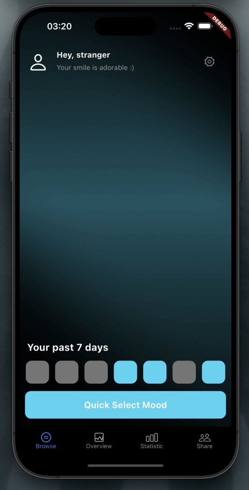

# mood

A RESTful API for mood tracking



## Getting Started

### Prerequisites

- [Java 25 (GraalVM)](https://www.graalvm.org/downloads/)
- [Gradle](https://gradle.org/install/)
- [Docker](https://docs.docker.com/get-docker/)

### Installation

Build the application:

```bash
gradle build
```

Run the application:

```bash
gradle quarkusDev
```

## Configuration

The server is configured via environment variables. For local development, see an example in `.env.example`.

### Required

| Variable            | Description                                    | Example                                 |
|---------------------|------------------------------------------------|-----------------------------------------|
| `QUARKUS_PROFILE`            | Active configuration profile (`dev`, `prod` or `test`) | Configuration profile: prod, dev or test (gradle quarkusDev uses dev) |
| `POSTGRES_JDBC_URL` | JDBC connection URL of the PostgreSQL database | `jdbc:postgresql://localhost:5432/mood` |
| `POSTGRES_USER`     | Database user                                  | `mood`                                  |
| `POSTGRES_PW`       | Database password                              |                                         |
| `MAILER_FROM`       | Sender address for outgoing e-mails            | `no-reply@example.com`                  |
| `MAILER_HOST`       | SMTP host                                      | `smtp.example.com`                      |
| `MAILER_USER`       | SMTP username                                  | `no-reply@example.com`                  |
| `MAILER_PW`         | SMTP password                                  |                                         |

### Optional

| Variable                     | Description                                            | Default                                                                         |
|------------------------------|--------------------------------------------------------|---------------------------------------------------------------------------------|
| `MAILER_PORT`                | SMTP port (TLS is always enabled)                      | `465`                                                                           |

Any other Quarkus property can be overridden with its environment variable equivalent.
See the [Quarkus configuration guide](https://quarkus.io/guides/config-reference#environment-variables) for details.

## Qodana

https://qodana.cloud/projects/zqPvd

## License

This program is licensed under the MIT-License. See the "LICENSE" file for more information
